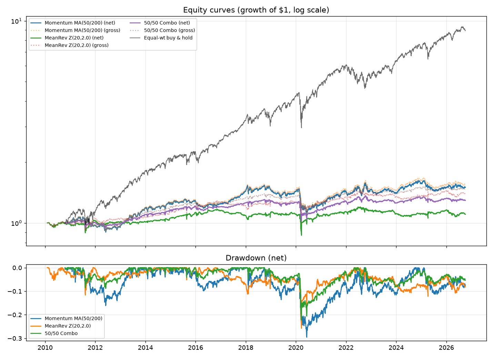

# Momentum & Mean Reversion Strategy Backtest

A single-file Python backtester that tests two classic equity anomalies, **momentum** (moving-average crossover) and **mean reversion** (rolling Z-score / Bollinger-style), on daily S&P 500 prices, and measures how much of the edge survives **transaction costs and slippage**.

## Overview

Academic and practitioner literature documents both trend-following and short-term reversal effects, but many published results disappear once realistic trading costs are applied. This project:

1. Downloads daily adjusted close prices for S&P 500 stocks.
2. Builds long/short signals for each strategy.
3. Simulates trading with a one-day execution lag and per-trade costs.
4. Sweeps lookback parameters to show how fragile (or robust) each result is.
5. Reports risk-adjusted performance and **alpha decay** as costs rise.

**Core concepts:** stationarity and mean reversion, rolling statistics, Sharpe / Sortino ratios, max drawdown, look-ahead / survivorship / data-snooping bias.

## Features

- **Momentum strategy:** long when the fast MA is above the slow MA, short otherwise (default 50/200).
- **Mean-reversion strategy:** rolling Z-score with entry and exit thresholds (default: enter at |Z| > 2.0, exit at |Z| < 0.5).
- **Continuous (log) returns**, with signals lagged one day so there is no look-ahead.
- **Transaction costs + slippage** charged on turnover (defaults: 5 bps + 2 bps, configurable).
- **Parameter sensitivity sweeps:**
  - Momentum: fast MA (10–100) × slow MA (50–200)
  - Mean reversion: lookback (10–200 days) × entry Z-threshold (1.0–3.0)
- **Alpha-decay analysis:** net Sharpe at 0–20 bps of cost.
- **Walk-forward sanity check:** picks the best parameters on the first 60% of data, then tests them on the last 40%.
- **Summary table:** CAGR, volatility, Sharpe, Sortino, max drawdown, Calmar, turnover, and the fraction of Sharpe lost to costs.
- **Equal-weight buy-and-hold benchmark** and a 50/50 momentum + mean-reversion combo.
- **Offline mode** (`--synthetic`) for testing without internet access.

## Tech Stack

| Tool | Role |
| --- | --- |
| Python 3.9+ | Language |
| pandas | Data handling, rolling statistics |
| NumPy | Vectorised math |
| matplotlib | Equity curves, heatmaps, decay chart |
| yfinance | Daily adjusted-close download |
| lxml | Parsing the S&P 500 list from Wikipedia (`pandas.read_html`) |

## Project Structure

```
.
├── momentum_meanrev_backtest.py   # the whole backtester (data, signals, engine, metrics, plots)
├── requirements.txt               # Python dependencies
├── tests/
│   └── test_backtest.py           # pytest suite (offline)
├── README.md
└── output/                        # created on first run
    ├── summary_stats.csv
    ├── equity_curves.png
    ├── sweep_momentum.png / .csv
    ├── sweep_meanrev.png / .csv
    └── alpha_decay.png
```

## Installation

### Step 1: Check prerequisites

You need **Python 3.9 or newer** and **pip**. Check with:

```bash
python3 --version
pip --version
```

If Python is missing, install it from [python.org/downloads](https://www.python.org/downloads/). On Windows, tick **"Add Python to PATH"** during setup.

### Step 2: Get the project files

Put `momentum_meanrev_backtest.py` and `requirements.txt` in a new folder, then open a terminal in that folder:

```bash
mkdir momentum-meanrev-backtest
cd momentum-meanrev-backtest
```

If you cloned the repository instead:

```bash
git clone <your-repo-url>
cd <your-repo-folder>
```

### Step 3: Create a virtual environment (recommended)

This keeps the project's packages separate from the rest of your system.

**macOS / Linux**
```bash
python3 -m venv .venv
source .venv/bin/activate
```

**Windows (PowerShell)**
```powershell
python -m venv .venv
.venv\Scripts\Activate.ps1
```

**Windows (Command Prompt)**
```cmd
python -m venv .venv
.venv\Scripts\activate.bat
```

Your prompt should now start with `(.venv)`.

### Step 4: Install dependencies

```bash
pip install -r requirements.txt
```

Or install them directly:

```bash
pip install pandas numpy matplotlib yfinance lxml
```

### Step 5: Verify the installation (offline smoke test)

This uses simulated prices, so it needs no internet connection:

```bash
python momentum_meanrev_backtest.py --synthetic
```

It should finish in roughly 10 seconds, print a summary table, and create an `output/` folder. If it does, everything is installed correctly.

### Step 6: Run on real market data

```bash
python momentum_meanrev_backtest.py
```

This downloads prices from Yahoo Finance for 50 S&P 500 tickers from 2010 onward. Open the files in `output/` to see the results.

## Usage

```bash
# Default: 50 tickers, 2010 to today, 5 bps cost + 2 bps slippage
python momentum_meanrev_backtest.py

# Full current S&P 500 (slower, and Yahoo may rate-limit large downloads)
python momentum_meanrev_backtest.py --n-tickers 500

# Different date range
python momentum_meanrev_backtest.py --start 2015-01-01 --end 2025-12-31

# Harsher trading costs
python momentum_meanrev_backtest.py --cost-bps 10 --slip-bps 5

# Custom strategy parameters
python momentum_meanrev_backtest.py --fast 20 --slow 100 --mr-window 40 --mr-entry 2.5

# Offline test
python momentum_meanrev_backtest.py --synthetic
```

| Flag | Default | Meaning |
| --- | --- | --- |
| `--n-tickers` | 50 | Number of S&P 500 tickers to use |
| `--start` / `--end` | 2010-01-01 / today | Date range |
| `--cost-bps` | 5.0 | Commission/fees per unit of turnover |
| `--slip-bps` | 2.0 | Slippage per unit of turnover |
| `--fast` / `--slow` | 50 / 200 | Momentum moving-average windows |
| `--mr-window` | 20 | Mean-reversion lookback |
| `--mr-entry` | 2.0 | Z-score entry threshold |
| `--synthetic` | off | Use simulated prices instead of downloading |

## Examples / Screenshots

After a run, see `output/equity_curves.png` (growth of $1, net and gross, plus drawdowns) and the heatmaps `sweep_momentum.png` and `sweep_meanrev.png`.

Example summary table (format only; **these numbers come from the `--synthetic` smoke test, not real markets**):

```
Strategy        Momentum MA(50/200)  MeanRev Z(20,2.0)  50/50 Combo  Equal-wt Buy&Hold
Sharpe (Gross)                0.268             -0.259        0.103              0.116
Sharpe (Net)                  0.244             -0.482       -0.050              0.116
Sortino (Net)                 0.354             -0.665       -0.070              0.196
MaxDD (Net)                  -0.163             -0.282       -0.113             -0.476
Ann.Turnover                  3.163             19.679       11.414              0.000
Sharpe decay                  0.089              0.860        1.482              0.000
```

Add your own real-data screenshots here after running on live prices:

```markdown

```

## Architecture

The script is one file organised into stages that flow top to bottom:

```
Data ──► Signals ──► Backtest engine ──► Metrics ──► Sweeps / Plots
(yfinance)  (±1/0)   (lag, weights,      (Sharpe,    (heatmaps, decay,
                      costs)              Sortino…)   walk-forward)
```

| Stage | Functions |
| --- | --- |
| Data | `get_sp500_tickers`, `load_prices_yf`, `make_synthetic_prices` |
| Signals | `momentum_signal`, `meanrev_signal` |
| Engine | `backtest` returns a `Result` (gross, net, turnover) |
| Metrics | `summarize`, `sharpe`, `max_drawdown`, `equity_curve` |
| Analysis | `sweep_momentum`, `sweep_meanrev`, `alpha_decay` |
| Output | `plot_equity`, `plot_heatmap`, `plot_decay`, `main` |

## Algorithms / Design

- **Returns:** log returns, `r_t = ln(P_t / P_{t-1})`, which add across time.
- **Momentum signal:** `sign(MA_fast − MA_slow)`, giving +1 (long) or −1 (short).
- **Mean-reversion signal:** `Z = (P − rolling mean) / rolling std`. Go long if `Z < −entry`, short if `Z > +entry`, flat when `|Z| < 0.5`, otherwise hold the prior position (hysteresis reduces churn).
- **Execution:** positions are shifted one day (`signal.shift(1)`), so a signal computed at today's close trades tomorrow.
- **Portfolio:** equal weight across stocks with a valid signal, with total gross exposure of 1.
- **Costs:** `cost = (cost_bps + slip_bps) / 10,000 × Σ|Δweight|` per day, subtracted from gross returns.
- **Metrics:**
  - Sharpe = annualised mean return ÷ annualised volatility (252 trading days, risk-free rate assumed 0)
  - Sortino = annualised mean return ÷ annualised downside deviation
  - Max drawdown = worst peak-to-trough decline of the equity curve
  - Sharpe decay = (gross Sharpe − net Sharpe) ÷ |gross Sharpe|

## Testing

The test suite lives in `tests/test_backtest.py` (26 tests, all offline). Run it from the project root:

```bash
pip install pytest
pytest -v
```

It covers:

- **Signals:** values limited to -1/0/+1, warm-up NaNs, trend direction, mean-reversion entries and hysteresis
- **Look-ahead:** a same-day signal earns nothing, while a deliberately leaked one explodes (control)
- **Costs:** zero cost makes net equal gross, cost drag equals turnover × bps, doubling costs doubles the drag
- **Metrics:** max drawdown and Sharpe against hand-computed values, zero-volatility handling
- **Sweeps:** grid shape, invalid MA pairs, net Sharpe falling as costs rise
- **End to end:** `main()` with `--synthetic` produces every output file

You can also run the quick smoke test directly: `python momentum_meanrev_backtest.py --synthetic`.

## Performance

- The synthetic smoke test (50 tickers, ~2,500 days, full sweeps and walk-forward) took about 9 seconds in the development environment.
- Signals and the backtest engine are vectorised in pandas. The mean-reversion hysteresis uses a Python loop over days, and it is the slowest part; every sweep cell reruns it.
- Running `--n-tickers 500` multiplies the work and the download time. Yahoo Finance may throttle large requests.

## Security

- The script only makes outbound requests to Yahoo Finance (via `yfinance`) and Wikipedia (the S&P 500 ticker list). It needs no API keys or credentials, and stores none.
- It writes only to the local `output/` folder.
- Install packages inside a virtual environment and pin versions in `requirements.txt` if you need reproducible, auditable builds.
- This project is research code, not financial advice, and it connects to no brokerage.

## Limitations

- **Survivorship bias:** the universe is today's S&P 500 constituents, which flatters results. Use point-in-time membership data for serious research.
- **Data-snooping risk:** sweeps are in-sample. The walk-forward check helps but is a single split, not a full out-of-sample study.
- **Simplified costs:** flat bps per trade; no bid-ask spread model, market impact, borrow fees for shorts, or financing costs.
- **No position limits or risk targeting:** equal weighting only; no volatility scaling or sector neutrality.
- **Yahoo data quality:** free data can contain gaps or errors, and tickers with under 90% coverage are dropped.
- Risk-free rate is assumed to be 0 in the Sharpe and Sortino ratios.

## Future Improvements

- Point-in-time S&P 500 constituents to remove survivorship bias
- Volatility-targeted and cross-sectional (long top decile / short bottom decile) portfolios
- Rolling walk-forward optimisation and bootstrap confidence intervals for Sharpe
- Spread, market-impact, and short-borrow cost models
- Unit tests (pytest) and CI
- Stationarity tests (ADF) to screen for mean-reverting names

## Troubleshooting

| Problem | Fix |
| --- | --- |
| `ModuleNotFoundError: No module named 'yfinance'` (or pandas, etc.) | Activate your virtual environment, then run `pip install -r requirements.txt`. |
| `ImportError: lxml not found` or Wikipedia scrape fails | Run `pip install lxml`. The script falls back to a built-in list of 50 large caps if the scrape fails. |
| Empty data or `No timezone found` / rate-limit errors from Yahoo | Wait a few minutes and retry, upgrade with `pip install -U yfinance`, or lower `--n-tickers`. |
| `python` not found | Use `python3` on macOS/Linux, or reinstall Python on Windows with "Add to PATH" ticked. |
| PowerShell blocks `Activate.ps1` | Run `Set-ExecutionPolicy -Scope CurrentUser RemoteSigned`, or use Command Prompt instead. |
| Plots do not pop up | Expected: figures are saved as PNG files in `output/` rather than displayed. |
| Run is very slow | Reduce `--n-tickers` or the date range. |
| Works offline but fails online | Check your network, VPN or proxy; `--synthetic` will keep working for testing. |

## License

MIT License

  Copyright (c) 2026 Beatrice Oira

    Permission is hereby granted, free of charge, to any person obtaining a copy of this
    software and associated documentation files (the "Software"), to deal in the Software
    without restriction, including without limitation the rights to use, copy, modify,
    merge, publish, distribute, sublicense, and/or sell copies of the Software, and to
    permit persons to whom the Software is furnished to do so.

    THE SOFTWARE IS PROVIDED "AS IS", WITHOUT WARRANTY OF ANY KIND, EXPRESS OR IMPLIED,
    INCLUDING BUT NOT LIMITED TO THE WARRANTIES OF MERCHANTABILITY, FITNESS FOR A
    PARTICULAR PURPOSE AND NONINFRINGEMENT. IN NO EVENT SHALL THE AUTHORS OR COPYRIGHT
    HOLDERS BE LIABLE FOR ANY CLAIM, DAMAGES OR OTHER LIABILITY, WHETHER IN AN ACTION
    OF CONTRACT, TORT OR OTHERWISE, ARISING FROM, OUT OF OR IN CONNECTION WITH THE
    SOFTWARE OR THE USE OR OTHER DEALINGS IN THE SOFTWARE.


## Author

Beatriceoira

*Disclaimer: this project is for education and research only. Backtested results do not guarantee future performance and are not investment advice.*
